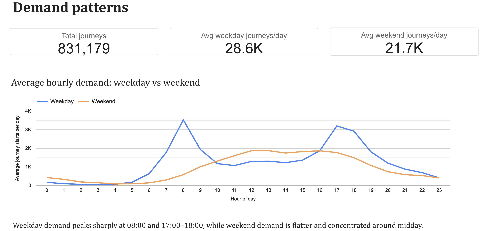
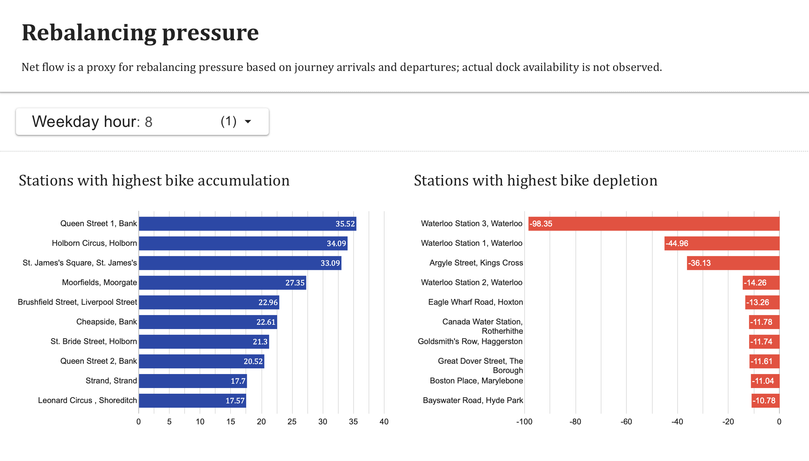
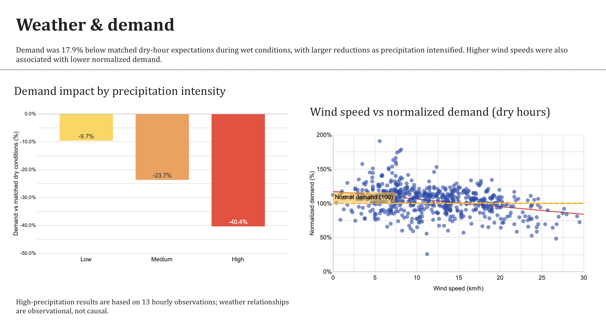

# London Bike-Share Operations & Rebalancing

An end-to-end data analytics project examining **when and where London bike-share demand creates potential fleet-rebalancing pressure, and how weather conditions relate to demand**.

The project analyzes **831,179 Santander Cycle Hire journeys from October 2024**, combines them with hourly historical weather data, and uses Python, BigQuery SQL, and Looker Studio to turn journey-level data into operational insights.

**Interactive dashboard:**  
[View the Looker Studio dashboard](https://datastudio.google.com/reporting/862c2c2e-a14f-4a0e-b1c5-e46a5e7fa191/page/5a9BG?hl=en)

---

## Business Question

> **Where and when should a bike-share operator prioritize fleet rebalancing to better match available bicycles with demand, and how does weather relate to that demand?**

Bike-share systems face an operational challenge: customer journeys continuously move bicycles between stations. Strong directional flows can leave some stations depleted while others accumulate bikes.

Because the available journey dataset does not contain live station inventory or dock-capacity information, this project uses **net journey flow as a proxy for potential rebalancing pressure** rather than claiming to observe actual bike shortages.

---

## Dashboard

### Demand Patterns



### Rebalancing Pressure



### Weather & Demand



The interactive dashboard allows weekday station flows to be explored by hour and summarizes demand patterns and weather relationships.

**[Open the interactive dashboard](https://datastudio.google.com/reporting/862c2c2e-a14f-4a0e-b1c5-e46a5e7fa191/page/5a9BG?hl=en)**

---

## Key Findings

### 1. Weekday demand is strongly commute-shaped

Average weekday demand was approximately **28.6K journeys per day**, compared with **21.7K on weekends** — about **32% higher**.

Weekday demand showed two clear peaks:

- **08:00:** approximately 3.5K journey starts per weekday
- **17:00:** approximately 3.2K journey starts per weekday

Weekend demand was lower and more evenly distributed, with activity concentrated more around midday and the afternoon.

The pattern is consistent with commuting behavior, although trip purpose is not directly observed in the dataset.

---

### 2. Station-flow pressure changes direction between morning and evening

Several stations showed strong directional imbalances during weekday commute periods.

At **08:00**, the strongest average depletion pressure included:

- **Waterloo Station 3:** approximately **-98 bikes per weekday**
- **Waterloo Station 1:** approximately **-45**
- **Argyle Street, King's Cross:** approximately **-36**

At the same time, stations around central employment areas accumulated bikes:

- **Queen Street 1, Bank:** approximately **+36**
- **Holborn Circus:** approximately **+34**
- **St. James's Square:** approximately **+33**

By the evening peak, much of this pattern reversed.

For example, Waterloo Station 3 shifted from approximately **-98 net bikes at 08:00** to approximately **+99 at 17:00**.

This suggests that rebalancing priorities should be **time-specific rather than based only on total monthly station usage**.

---

### 3. Wet conditions were associated with substantially lower demand

A simple wet-versus-dry comparison was potentially misleading because weather conditions occur at different times of day and on different types of days.

To control for this, each wet hour was compared with typical dry demand for the **same hour of day and weekday/weekend category**.

Across **146 wet hours**:

- Actual journey starts: **155,031**
- Expected starts under matched dry conditions: approximately **188,805**
- Difference: **-17.9%**

The reduction was larger on weekends:

- **Weekdays:** approximately **-15.5%**
- **Weekends:** approximately **-26.1%**

---

### 4. Demand fell further as precipitation intensified

Wet hours were divided into project-specific precipitation-intensity groups:

| Precipitation group | Wet hours | Demand vs. matched dry conditions |
|---|---:|---:|
| Low | 84 | **-9.7%** |
| Medium | 49 | **-23.7%** |
| High | 13 | **-40.4%** |

These categories are analytical groupings created for this project rather than official meteorological classifications.

The high-precipitation result should be interpreted cautiously because it is based on only **13 hourly observations**.

---

### 5. Higher wind speeds were also associated with lower demand

Demand was normalized against typical demand for the same hour and weekday/weekend category.

Higher wind-speed groups showed progressively lower normalized demand. The relationship remained visible when the analysis was restricted to **dry hours**, suggesting that the wind relationship was not explained only by rainfall.

Temperature, by contrast, did not show a clear directional relationship with demand during October and was therefore not emphasized in the final dashboard.

---

## Business Recommendations

### 1. Prioritize rebalancing around weekday commute peaks

Weekday demand peaks sharply at 08:00 and again at 17:00–18:00, so operators should concentrate replenishment and redistribution efforts before and during these high-demand periods, especially at stations showing the strongest depletion pressure.

### 2. Focus on stations with the strongest directional flow imbalances

Major transport hubs such as Waterloo and King's Cross show strong morning bike depletion, while stations around Bank, Holborn, and St. James's tend to accumulate bikes during the same period, with much of the pattern reversing in the evening.

These flows suggest opportunities for targeted redistribution between high-depletion and high-accumulation areas, while actual inventory and dock capacity should be monitored to determine required quantities.

### 3. Adjust rebalancing activity based on weather conditions

Wet hours were associated with demand about 17.9% below comparable dry conditions, with progressively larger reductions as precipitation intensified. Higher wind speeds were also associated with lower normalized demand.

Forecast weather could therefore be incorporated into daily rebalancing plans, reducing or delaying some redistribution activity during poor conditions while maintaining sufficient capacity for essential peak-period demand.

### 4. Use different operating strategies for weekdays and weekends

Weekdays show higher daily demand and sharp commute-driven peaks, while weekend demand is lower and more evenly distributed around late morning and afternoon.

Rebalancing schedules should therefore be more time-sensitive on weekdays and more evenly spread across the day on weekends.

---

## Data Sources

### Transport for London — Cycle Hire Journeys

Two TfL journey extracts were used:

- `405JourneyDataExtract01Oct2024-14Oct2024.csv`
- `406JourneyDataExtract15Oct2024-31Oct2024.csv`

Source:  
[TfL Cycling Open Data](https://cycling.data.tfl.gov.uk/#!usage-stats%2F)

Additional TfL open-data information:  
[TfL Open Data](https://tfl.gov.uk/info-for/open-data-users/our-open-data?intcmp=3671)

The raw journey files are not committed to this repository because of their size. Instructions are available in [`data/raw/README.md`](data/raw/README.md).

### Open-Meteo — Historical Weather

Hourly historical weather was retrieved for central London using the Open-Meteo Historical Weather API.

Variables used:

- temperature at 2 m
- precipitation
- wind speed at 10 m
- WMO weather code

Source:  
[Open-Meteo Historical Weather API](https://open-meteo.com/en/docs/historical-weather-api)

The UTC API snapshot used by the analysis is retained in `data/weather/` for reproducibility.

Users should consult the original data providers for current licensing and terms of use.

---

## Tools & Technologies

| Tool | Use in project |
|---|---|
| **Excel** | Initial dataset inspection and profiling, including schema review, missing-value checks, duplicate checks, and date-range validation |
| **Python / Pandas** | Data validation, cleaning, transformation, station-flow analysis, weather integration, and exploratory analysis |
| **BigQuery SQL** | Analytical queries, CTEs, joins, window functions, matched weather baselines, and dashboard-ready views |
| **Google Cloud BigQuery** | Cloud data warehouse for the validated journey and weather datasets |
| **Looker Studio** | Interactive business dashboard |
| **Parquet** | Efficient intermediate storage between Python and BigQuery |

---

## Project Workflow

```text
TfL Cycle Hire journey data
            +
Open-Meteo historical weather
            │
            ▼
    Excel initial profiling
            │
            ▼
      Python / Pandas
 validation, cleaning, DST handling,
 transformation, weather integration
            │
            ▼
       Parquet outputs
            │
            ▼
    Google BigQuery
 analytical SQL + dashboard views
            │
            ▼
      Looker Studio
 interactive operations dashboard
```

---

## Data Validation & Cleaning

The two TfL extracts contained **831,184 raw journey records**.

Five journeys began exactly at `2024-11-01 00:00`, so the final October analysis window was explicitly defined as:

```text
2024-10-01 00:00 <= start_datetime < 2024-11-01 00:00
```

This resulted in **831,179 October journeys**.

Key validation decisions included:

### Journey IDs

No duplicate journey IDs were found within either source extract or across the combined files.

### Missing values

No missing values were identified in the original 11 TfL journey fields.

### Journey duration

TfL timestamps are recorded only to the minute, while `Total duration (ms)` contains more precise elapsed-duration information.

The timestamp-derived duration therefore differed slightly from the supplied duration for most journeys.

`Total duration (ms)` was retained as the authoritative elapsed-duration measure.

### Daylight Saving Time

The UK returned from British Summer Time to Greenwich Mean Time on **27 October 2024**.

This created **71 journeys where the recorded local end time appeared earlier than the start time**. After accounting for the one-hour clock rollback, the records were consistent with the supplied elapsed-duration field.

These journeys were therefore retained rather than incorrectly removed as invalid records.

The repeated local `01:00` weather hour on the DST transition was excluded from the hourly bike-weather merge because the minute-level TfL timestamps cannot distinguish between the two occurrences of that clock hour.

### Long-duration journeys

A small number of journeys had unusually long recorded durations.

Rather than deleting them without supporting evidence, these records were retained because duration was not the primary variable driving the rebalancing analysis.

Robust statistics such as medians and percentiles were used when examining duration.

### Operational locations

Three stations appeared only as journey destinations during the month.

Two were clearly named mechanical workshops and were retained in the source data but flagged so they could be excluded from customer-facing station-pressure visuals.

---

## Analysis Methodology

### Demand Patterns

Journey starts were aggregated by:

- calendar date
- day of week
- weekday/weekend
- hour of day

Daily averages were calculated rather than comparing raw weekday totals, because October 2024 contains different numbers of each weekday.

---

### Rebalancing Pressure

For each station:

```text
Net flow = arrivals - departures
```

Interpretation:

- **Negative net flow:** more bikes leave than arrive → potential depletion pressure
- **Positive net flow:** more bikes arrive than leave → potential accumulation pressure

Weekday station-hour flows were divided by the **23 weekdays in October 2024** to calculate average net flow per weekday.

This metric is a **proxy for operational pressure**. It does not measure actual station inventory or dock availability.

---

### Weather Matching

Bike demand was aggregated into hourly local-clock bins and joined to Open-Meteo weather observations.

To avoid comparing structurally different periods, wet hours were evaluated against a dry baseline defined by:

```text
same hour of day
+
same weekday/weekend category
```

For each wet hour:

```text
Difference from dry expectation
=
(actual demand - matched dry baseline)
/
matched dry baseline
```

This provided a more meaningful weather comparison than the raw average demand of all wet hours versus all dry hours.

---

### Normalized Demand

For wind and temperature analysis, demand was normalized against typical demand for the corresponding hour and weekday/weekend category:

```text
Demand index (%)
=
actual hourly demand
/
typical demand for same hour and day type
× 100
```

A value of:

- `100%` = typical demand
- `<100%` = below typical demand
- `>100%` = above typical demand

---

## SQL Analysis

The BigQuery portion of the project demonstrates:

- CTEs
- `CASE` expressions
- date and time extraction
- aggregation
- `FULL OUTER JOIN`
- `COALESCE`
- `SAFE_DIVIDE`
- window functions
- `ROW_NUMBER()`
- matched-baseline analysis
- reusable SQL views for BI reporting

### Core analytical queries

| File | Purpose |
|---|---|
| [`01_hourly_demand_by_day_type.sql`](sql/01_hourly_demand_by_day_type.sql) | Average hourly demand for weekdays vs. weekends |
| [`02_station_net_flow.sql`](sql/02_station_net_flow.sql) | Monthly station arrivals, departures, and net flow |
| [`03_station_peak_pressure.sql`](sql/03_station_peak_pressure.sql) | Strongest weekday station-hour rebalancing pressure |
| [`04_weather_demand.sql`](sql/04_weather_demand.sql) | Controlled wet-vs-dry demand comparison |
| [`05_rain_intensity.sql`](sql/05_rain_intensity.sql) | Demand effect by precipitation intensity |

### Dashboard views

Files `06`–`11` create the BigQuery views used by Looker Studio:

- hourly demand
- station pressure
- weather demand
- KPI summary
- precipitation intensity
- dry-hour wind demand

---

## Notebooks

### [`01_initial_validation.ipynb`](notebooks/01_initial_validation.ipynb)

Covers:

- source-file validation
- duplicate and missing-value checks
- datetime parsing
- extract-boundary validation
- duration validation
- DST investigation
- station validation
- duration outliers
- temporal demand patterns
- station net-flow analysis
- BigQuery-ready journey export

### [`02_weather_integration.ipynb`](notebooks/02_weather_integration.ipynb)

Covers:

- Open-Meteo retrieval
- UTC-to-London time conversion
- DST-safe weather preparation
- hourly demand aggregation
- bike-weather integration
- matched dry-hour baseline
- precipitation-intensity analysis
- wind analysis
- temperature analysis
- BigQuery-ready weather export

---

## Limitations

1. **One-month analysis period.**  
   The project analyzes October 2024 only, so the patterns may not represent other seasons or the full year.

2. **Net journey flow is only a proxy for rebalancing pressure.**  
   The dataset does not include live station inventory, dock capacity, empty-station events, or full-dock events.

3. **Existing operator rebalancing is not observed.**  
   Bikes may already have been redistributed by the operator during the month, but those operational movements are not captured as customer journeys.

4. **Weather is represented by one London-area observation point.**  
   Localized weather differences across the full bike-share network are therefore not captured.

5. **Weather relationships are observational.**  
   The analysis identifies associations rather than proving that precipitation or wind causes changes in demand.

6. **Some weather categories have small samples.**  
   The high-precipitation group contains only 13 hourly observations.

7. **DST creates unavoidable local-time ambiguity.**  
   TfL's minute-level local timestamps cannot distinguish between the two occurrences of 01:00 during the October clock rollback.

---

## Next Steps

Potential extensions include:

- Extend the pipeline to a **full year of journeys** to evaluate seasonality.
- Integrate **live station capacity and inventory data** to measure actual shortage and full-dock risk.
- Add operator rebalancing records, if available, to distinguish customer flows from operational bike movements.
- Combine station pressure with **distance, vehicle capacity, and staffing constraints** to design practical redistribution routes.
- Test weather relationships across additional months and incorporate stable effects into short-term demand forecasts.

---

## Repository Structure

```text
bike-share-operations/
│
├── README.md
├── .gitignore
│
├── dashboard/
│   ├── demand_patterns.png
│   ├── rebalancing_pressure.png
│   └── weather_demand.png
│
├── data/
│   ├── raw/
│   │   └── README.md
│   │
│   ├── processed/
│   │   └── generated locally; excluded from Git
│   │
│   └── weather/
│       └── open_meteo_london_october_2024_utc.json
│
├── notebooks/
│   ├── 01_initial_validation.ipynb
│   └── 02_weather_integration.ipynb
│
└── sql/
    ├── 01_hourly_demand_by_day_type.sql
    ├── 02_station_net_flow.sql
    ├── 03_station_peak_pressure.sql
    ├── 04_weather_demand.sql
    ├── 05_rain_intensity.sql
    ├── 06_dashboard_hourly_demand.sql
    ├── 07_dashboard_station_pressure.sql
    ├── 08_dashboard_weather_demand.sql
    ├── 09_dashboard_kpis.sql
    ├── 10_dashboard_rain_intensity.sql
    └── 11_dashboard_wind_demand.sql
```

---

## Reproducing the Analysis

### 1. Download the TfL source files

Download the two October 2024 journey extracts listed above and place them in:

```text
data/raw/
```

### 2. Install the Python dependencies

```bash
python -m pip install pandas pyarrow requests
```

### 3. Run the notebooks in order

```text
01_initial_validation.ipynb
02_weather_integration.ipynb
```

Notebook 01 creates the validated journey dataset used by Notebook 02.

The notebooks also create the Parquet files used for loading data into BigQuery.

### 4. Load data into BigQuery

Load the generated BigQuery-ready Parquet datasets into your own Google Cloud project.

The SQL files in this repository reference the project/dataset used during development. Replace those table paths with your own **GCP project ID and BigQuery dataset name** before running them.

### 5. Run the SQL scripts

Run the SQL files in numerical order.

Scripts `01`–`05` reproduce the core analysis, while `06`–`11` create the reporting views used by the Looker Studio dashboard.

---

## Project Summary

This project demonstrates an end-to-end analytics workflow across **Excel, Python/Pandas, SQL, BigQuery, and Looker Studio**, with an emphasis on:

- data quality
- reproducible transformations
- time-series validation
- business-focused metrics
- cloud SQL analysis
- evidence-based recommendations
- clear communication of analytical limitations

The goal was not simply to describe bike-share usage, but to translate journey and weather data into **defensible operational insights for fleet-rebalancing decisions**.